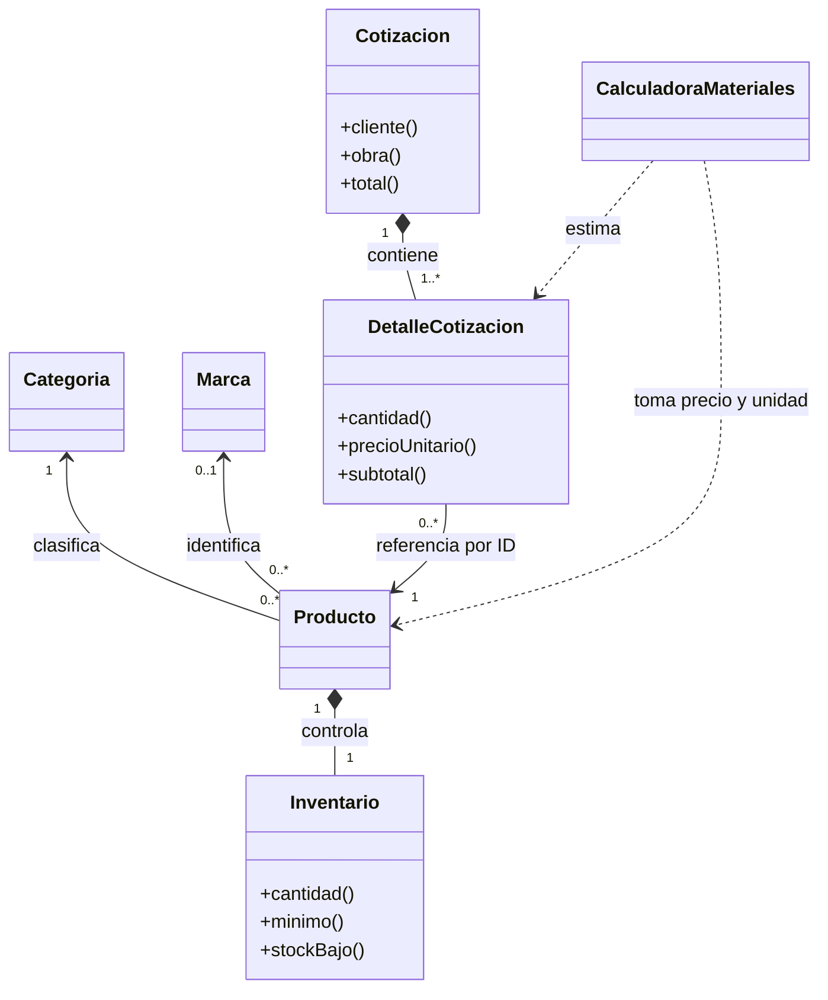

# Diagrama de clases implementado

El diagrama original describe el sistema completo. Esta vista corresponde al código Swing/JDBC de la segunda entrega.

El tipo de obra se implementó como `enum TipoObra` con tres opciones. El modelo registra el nombre del cliente al cotizar. El detalle guarda el ID de producto y una copia de su nombre, unidad y precio para conservar el historial.
